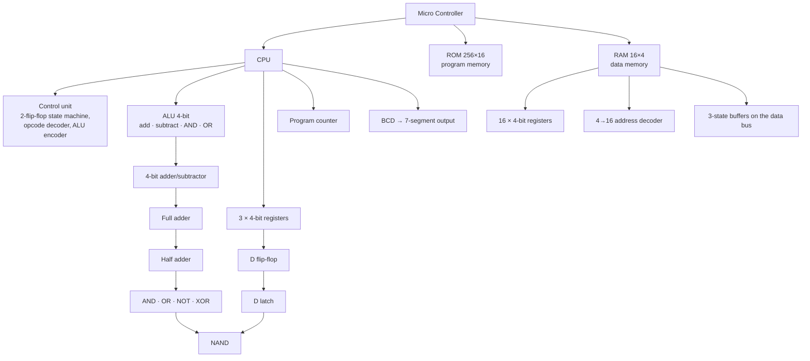

# Harvard-Architecture 4-bit CPU in Digital Logic Sim

A simple 4-bit CPU and memory system built in [Digital Logic Sim](https://github.com/SebLague/Digital-Logic-Sim) (v2.1), starting from NAND gates. Every block above the NAND gate (logic gates, latches, flip-flops, adders, registers, ALU, control unit, RAM) was designed by hand, then combined into a microcontroller with separate program and data memory (**Harvard architecture**).

It is a simple design, made to understand how a processor works inside.

## Architecture

- **Instruction path:** the program counter addresses the ROM, the control unit decodes the opcode and generates the control signals: register enables, ALU operation select and PC increment.
- **Data path:** two operand registers feed the ALU, the result is stored in a third register and can be written to or read from the RAM through a 4-bit bus with 3-state buffers.
- **ALU:** a 4-bit adder/subtractor (two's complement, with a carry/overflow flag) plus AND and OR, selected with two control bits through 4:1 multiplexers.
- The ROM is the simulator's built-in component. Everything else is custom.

## Chip library

| Level | Chips |
|---|---|
| Gates | NOT, AND, OR, NOR, XOR, XNOR, AND-3, AND-4, OR-4 (all from NAND) |
| Combinational | Half/Full adder, 4-bit adder/subtractor, 1-bit comparator, 2:1, 4:1 and 8:1 MUX, 1:2 DEMUX, 2→4 and 4→16 decoders, 4→2 encoder, BCD → 7-segment decoder |
| Sequential | SR latch (with and without enable), D latch, D, JK and T flip-flops, 1-bit and 4-bit registers |
| Processor | ALU (4-bit), program counter, control unit and its decoder, CPU |
| Memory | RAM 8×4, RAM 16×4, 3-state buffer (4-bit), Micro Controller |

## How to open it

1. Install [Digital Logic Sim](https://sebastian.itch.io/digital-logic-sim) (v2.1 or later).
2. Copy the `Electronics` folder into the simulator's projects folder:
   `%USERPROFILE%\AppData\LocalLow\SebastianLague\Digital-Logic-Sim\Projects\`
3. Open the **Electronics** project and place the `Micro Controller` or `CPU` chip.

## Next steps

A more complete version is planned.

## Author

Andreu Bueno Álvarez — Aerospace Systems Engineering, EETAC–UPC.
